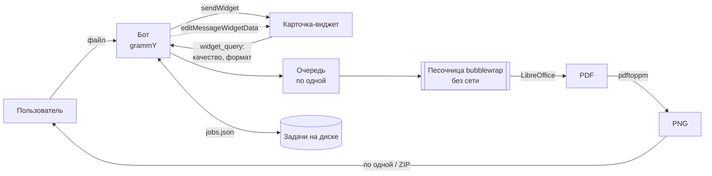

<div align="center">


# Pngify

**Telegram-бот: презентации, Word, Excel и PDF → PNG-картинки**<br>
<sub>Telegram bot that turns slides, documents, spreadsheets and PDFs into PNG images — with a live HTML widget card</sub>

[](https://t.me/PngifyBot)


**[▶ Попробовать в Telegram](https://t.me/PngifyBot)**

</div>

---

Присылаешь файл и получаешь каждую страницу или слайд отдельной PNG-картинкой либо одним ZIP. На каждый файл приходит **живая карточка-виджет**: в ней выбираешь качество и формат, а потом смотришь полоску прогресса. Всё работает на своём сервере, без внешних сервисов конвертации, и файлы удаляются сразу после отправки.

## ✨ Возможности

- 📄 **Почти любой офисный формат**: PowerPoint (`pptx`, `ppt`, `ppsx`), Word (`docx`, `doc`, `rtf`, `txt`), Excel (`xlsx`, `xls`, `csv`), PDF, OpenDocument, Keynote, Pages, Numbers, Visio.
- 🪟 **Карточка-виджет Telegram** (Bot API 10.4): значок формата, размер, переключатель «Обычное / Чёткое», кнопки «Картинками» и «ZIP-архивом», затем полоска с процентами. Под карточкой нет лишнего текста.
- 🔢 **Строгий порядок**: страница 1 приходит первой, 2 — второй. Каждая страница уходит сразу, как нарисована, поэтому первая приходит через секунды.
- 📦 **ZIP с понятными именами**: `Отчёт-01.png`, `Отчёт-02.png`… Русские имена читаются в Windows и macOS (флаг UTF-8).
- 🐘 **Файлы до 2 ГБ** через свой сервер Bot API (обычный облачный — до 20 МБ).
- 🔁 **Переживает перезапуск и падение**: начатые файлы доделываются сами, без повторов и пропусков.

## 🏗 Как устроено



| Часть | Файл |
|---|---|
| Бот: приём файлов, задачи, восстановление после перезапуска | `src/index.ts` |
| Карточка-виджет: HTML, состояние, полоска прогресса | `src/widget.ts` |
| Отправка и обновление карточки (виджет или обычный текст) | `src/cards.ts` |
| Задачи на диске и правила восстановления | `src/store.ts` |
| LibreOffice, pdftoppm, ZIP, песочница | `src/convert.ts` |
| Форматы, подпись файла, имена картинок | `src/formats.ts` |
| Очередь «по одной» | `src/queue.ts` |

## 🧠 Инженерные решения

| Задача | Решение |
|---|---|
| Живая карточка в сообщении | [HTML-виджет Telegram](https://core.telegram.org/bots/widgets): код неизменен после отправки, бот меняет только состояние (`chat_data`, ≤ 1024 байт). Кнопки шлют `widget_query`. Карточка сжата до ~2,4 КБ при пределе 4 КБ — это проверяет тест |
| В виджете нет сети и места под картинки | Карточка служит пультом и табло, а PNG приходят отдельными сообщениями. Если клиент виджетов не умеет, есть запасные кнопки и команды `/png` и `/zip` |
| Чужие документы могут быть опасны | LibreOffice и pdftoppm работают в **bubblewrap**: без сети, файловая система только на чтение, свой `/tmp`. Бот запущен от отдельного пользователя, systemd ограничивает его до 1,5 ГБ памяти и 2 ядер, чтобы соседние сервисы на сервере не страдали |
| Мусор с расширением `.docx` | **Проверка подписи файла** по первым байтам: ZIP, OLE, `%PDF`. Иначе LibreOffice откроет мусор как текст и пришлёт страницы абракадабры. Документ под паролем узнаётся отдельно |
| Альбомы перемешивают порядок | Без альбомов: одна страница — одно сообщение, следующая уходит только после ответа Telegram |
| Перезапуск посреди работы | Задачи (ссылки Telegram на файлы, не сами файлы) лежат в `jobs.json` с номером последней отправленной страницы. После запуска кнопки старых карточек работают, начатое продолжается. Файл, дважды уронивший бота, больше не берётся |
| Telegram просит подождать | `@grammyjs/auto-retry` для 429 и 5xx. Обновления карточки сжимаются: не чаще раза в 1,5 секунды |
| Файлы больше 20 МБ | Свой `telegram-bot-api` (`--local`) отдельным контейнером от того же пользователя: бот забирает скачанный файл перемещением, и копии не остаётся |

Проверено вживую со второго аккаунта: перезапуск службы и `kill -9` посреди задачи, битый файл, презентация на 71 МБ, 25 слайдов строго по порядку.

## 📏 Лимиты

| | Все | Владелец |
|---|---|---|
| Размер файла | 200 МБ | 2000 МБ (предел Telegram для ботов) |
| Страниц | 60 | 500 |
| Одновременно | 3 файла в работе, 15 в минуту | без ограничений |

## 🚀 Запуск

Нужны Node.js 22+, а на сервере ещё:

```bash
apt-get install --no-install-recommends \
  libreoffice-core-nogui libreoffice-writer-nogui libreoffice-impress-nogui \
  libreoffice-calc-nogui libreoffice-draw-nogui poppler-utils bubblewrap \
  fonts-dejavu-core fonts-liberation fonts-liberation2 \
  fonts-crosextra-carlito fonts-crosextra-caladea fonts-noto-core
```

Шрифты Carlito и Caladea совпадают по метрикам с Calibri и Cambria, Liberation — с Arial и Times New Roman. Поэтому вёрстка документов из Office не съезжает.

<details>
<summary>Ubuntu 24.04: профиль AppArmor для bubblewrap</summary>

Без него bubblewrap не может отключить сеть (`kernel.apparmor_restrict_unprivileged_userns = 1`):

```
# /etc/apparmor.d/bwrap-pngify
abi <abi/4.0>,
include <tunables/global>
profile bwrap /usr/bin/bwrap flags=(unconfined) {
  userns,
}
```

</details>

<details>
<summary>Свой сервер Bot API (файлы до 2 ГБ, нужна версия 10.4+)</summary>

```bash
install -d -o pngify -g pngify -m 700 /var/lib/pngify/botapi /var/lib/pngify/botapi/tmp
docker run -d --name pngify-bot-api --restart unless-stopped --user $(id -u pngify):$(id -g pngify) --memory 300m \
  --env-file /etc/pngify-botapi.env -p 127.0.0.1:8083:8081 \
  -v /var/lib/pngify/botapi:/var/lib/telegram-bot-api \
  --entrypoint telegram-bot-api aiogram/telegram-bot-api:latest \
  --local --http-port=8081 --dir=/var/lib/telegram-bot-api --temp-dir=/var/lib/telegram-bot-api/tmp
```

`api_id` и `api_hash` берутся с [my.telegram.org](https://my.telegram.org). Перед первым запуском бота один раз выводят из облака: `curl https://api.telegram.org/bot<токен>/logOut`.

</details>

```bash
cp .env.example .env   # токен и настройки; на сервере — /etc/pngify-bot.env (600)
npm install
npm test               # 23 теста: пределы виджета, прогресс, подписи файлов, восстановление, лимиты, очередь
npm start              # локально без bubblewrap: SANDBOX=0
```

Выкладка: `PNGIFY_HOST=root@<сервер> deploy/deploy.sh`. Скрипт прогоняет типы и тесты, копирует код через rsync (секреты не копирует), ставит службу `deploy/pngify-bot.service` и перезапускает её.

## 🧰 Стек

TypeScript · Node.js 22 · [grammY](https://grammy.dev) · Telegram Bot API 10.4 (HTML-виджеты) · LibreOffice headless · Poppler · bubblewrap · systemd · Docker (`telegram-bot-api`)

Аватарка нарисована кодом: `assets/avatar.py` (Pillow).

## 📄 Лицензия

[MIT](LICENSE) © digmen
